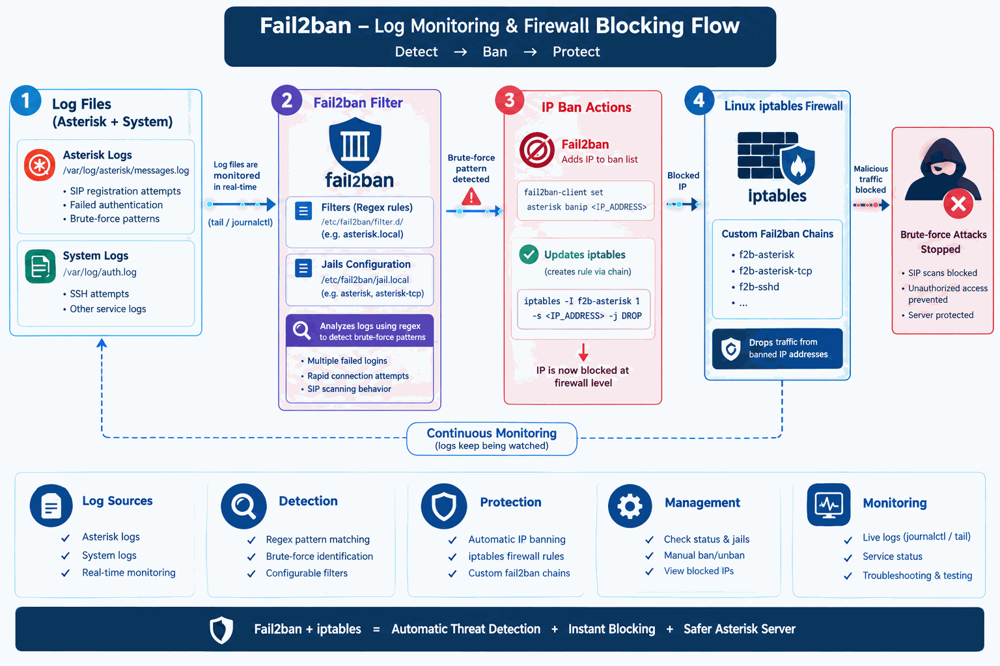
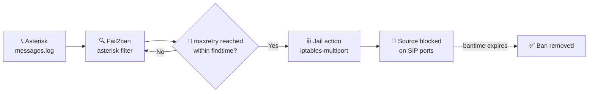
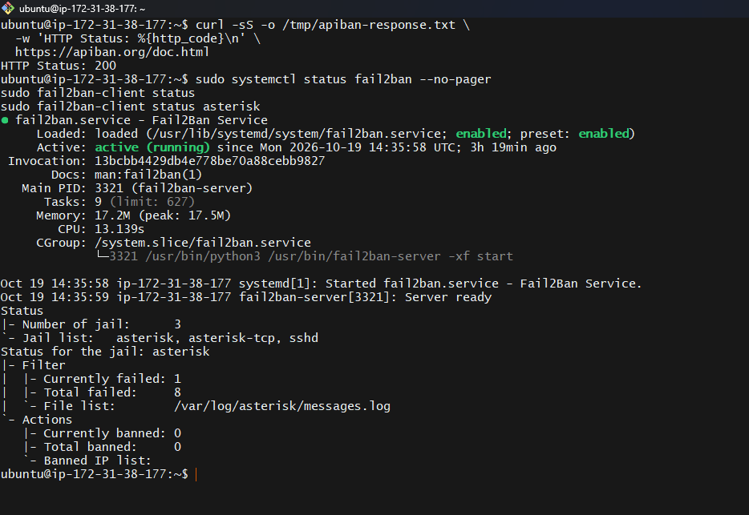

<div align="center">

# 🛡️ Fail2ban for Asterisk

**Automatically block SIP scanners and brute-force attackers before they reach your PBX.**


[Quick Start](#-quick-start) •
[How It Works](#-how-it-works) •
[Detection](#-detection-coverage) •
[Configuration](#%EF%B8%8F-configuration-reference) •
[Troubleshooting](#-troubleshooting)

</div>

---

This project provides a Fail2ban **filter** and **two jails** (UDP and TCP) that detect common Asterisk SIP scanning and authentication failures. Fail2ban reads local Asterisk logs and applies firewall bans after repeated matching events.

> [!NOTE]
> It is independent of APIban and can be used alongside other firewall controls.

## 📑 Contents

- [How It Works](#-how-it-works)
- [Detection Coverage](#-detection-coverage)
- [Requirements](#-requirements)
- [Quick Start](#-quick-start)
- [Validation and Operations](#-validation-and-operations)
- [Configuration Reference](#%EF%B8%8F-configuration-reference)
- [Security and Deployment Notes](#-security-and-deployment-notes)
- [Troubleshooting](#-troubleshooting)
- [Project Files](#-project-files)

---

## 🏗️ How It Works

<div align="center">



</div>



1. Asterisk writes security-related events to `/var/log/asterisk/messages.log`.
2. Fail2ban reads the file and applies the `asterisk` filter.
3. Matching events are counted per source in each enabled jail.
4. When a source reaches the retry threshold inside the time window, the jail runs its `iptables-multiport` action and blocks that source on the configured SIP ports.
5. Fail2ban removes the ban after the configured duration.

<div align="center">



*Example: Fail2ban service and jail status*

</div>

---

## 🎯 Detection Coverage

The included filter is based on **Asterisk 20.5.0** log formats.

| Area | What is detected |
| --- | --- |
| 🔐 **PJSIP** | `OPTIONS`, `INVITE`, and `REGISTER` requests failing because no endpoint matches or authentication fails |
| 📦 **PJProject** | UDP packet processing errors |
| 🕰️ **chan_sip** (legacy) | Registration failures caused by a wrong password or missing peer |

> [!IMPORTANT]
> The filter expects recognized Asterisk severity/log prefixes and supports the two date formats listed in its `datepattern`. Log format changes, different Asterisk versions, or different logger configuration may require adjusting the filter. **Always verify matches against this host's actual log before enabling bans.**

---

## 📋 Requirements

- ✅ Linux with Fail2ban and Asterisk installed and logging the relevant events
- ✅ Read access for Fail2ban to `/var/log/asterisk/messages.log`
- ✅ A firewall backend compatible with the configured `iptables-multiport` action
- ✅ Administrative access to install configuration and manage the Fail2ban service

The sample jails cover SIP ports `5060` and `5061`, separately for **UDP** and **TCP**. Change the ports, protocols, log path, and action to match the server's actual Asterisk exposure and firewall backend.

---

## 🚀 Quick Start

### Step 1 · Install files

Run from this repository directory:

```bash
sudo apt update
sudo apt install -y fail2ban
sudo install -o root -g root -m 644 filter.d-asterisk.local /etc/fail2ban/filter.d/asterisk.local
sudo install -o root -g root -m 644 jail.d-asterisk.local /etc/fail2ban/jail.d/asterisk.local
```

### Step 2 · Edit the jail configuration

Open `/etc/fail2ban/jail.d/asterisk.local` **before starting the service**.

- In **both** `[asterisk]` and `[asterisk-tcp]`, review `ignoreip` and add trusted administrator addresses and SIP providers.
- The TCP jail contains `YOUR_HOME_IP` and `YOUR_PROVIDER_IP` placeholders. Replace or remove them with valid addresses/networks.
- The UDP jail currently ignores loopback and RFC1918 private networks, which may not suit every deployment.
- Check and update `logpath`, `port`, and the firewall `action` to match the host.

> [!WARNING]
> Do not start Fail2ban with the placeholders still in place, and keep out-of-band access available in case a legitimate address gets blocked.

### Step 3 · Test the filter against real logs

```bash
sudo fail2ban-regex /var/log/asterisk/messages.log /etc/fail2ban/filter.d/asterisk.local
```

Inspect the matched and missed lines. Do not rely on the jails unless expected failure events match and ordinary traffic is **not** being matched.

### Step 4 · Start and verify

```bash
sudo systemctl enable --now fail2ban
sudo systemctl status fail2ban
sudo fail2ban-client status
sudo fail2ban-client status asterisk
sudo fail2ban-client status asterisk-tcp
```

---

## 🔧 Validation and Operations

After changing a filter or jail, test the filter and restart Fail2ban:

```bash
sudo fail2ban-regex /var/log/asterisk/messages.log /etc/fail2ban/filter.d/asterisk.local
sudo systemctl restart fail2ban
sudo journalctl -u fail2ban -n 50 --no-pager
```

<details>
<summary><b>📊 Status and live-log commands</b></summary>

```bash
sudo fail2ban-client status
sudo fail2ban-client status asterisk
sudo fail2ban-client status asterisk-tcp
sudo journalctl -u fail2ban -f
sudo tail -f /var/log/asterisk/messages.log
```

</details>

<details>
<summary><b>🔓 Remove a ban</b></summary>

Specify the jail and the address:

```bash
sudo fail2ban-client set asterisk unbanip 203.0.113.10
```

Use a real address in place of the documentation-only example above.

</details>

📖 More service, ban/unban, and regex-testing commands: [command cheat sheet](fail2ban_command_cheat_sheet.md).

---

## ⚙️ Configuration Reference

| Setting | Example value | Meaning |
| --- | --- | --- |
| `maxretry` | `3` | Number of matching events before a ban |
| `findtime` | `10m` | Time window used to count events |
| `bantime` | `7d` | Initial ban duration |
| `bantime.increment` | `true` | Enables longer bans for repeat offenders |
| `bantime.factor` | `2` (UDP jail) | Escalation factor configured for the UDP jail |
| `bantime.maxtime` | `30d` (UDP jail) | Maximum escalation duration configured for the UDP jail |
| `ignoreip` | loopback / private ranges | Sources excluded from banning; tailor carefully to the host |
| `action` | `iptables-multiport` | Firewall action used to block the source on the jail's ports/protocol |

> [!NOTE]
> The TCP jail enables incremental ban time but does not set its own `bantime.factor` or `bantime.maxtime`, so Fail2ban defaults may determine its escalation behavior.

---

## 🔒 Security and Deployment Notes

- ⚠️ Incorrect `ignoreip` or `maxretry` values can block legitimate administrators, providers, or users. Test with a management console or out-of-band access available.
- 🔁 The UDP jail ignores RFC1918 ranges; the TCP jail has additional placeholders. Review both lists rather than assuming they are interchangeable.
- 🧱 `iptables-multiport` must work with the host's active firewall backend. Do not assume it is compatible with every nftables/firewall-manager configuration.
- 📜 Ensure Asterisk's log rotation and Fail2ban's log backend are compatible, and that the configured file is readable by Fail2ban.
- 🛑 This configuration is a **starting point**, not a substitute for network-level access controls, SIP TLS, strong credentials, or monitoring.


## 📁 Project Files

| File | Purpose |
| --- | --- |
| `filter.d-asterisk.local` | Filter patterns and supported timestamp formats |
| `jail.d-asterisk.local` | UDP and TCP jail settings and firewall actions |
| `fail2ban_command_cheat_sheet.md` | Operational command reference |
| `docs/fail2ban_animated_flow.gif` | Architecture diagram |
| `docs/Fail2ban-Status.png` | Example service and jail status screenshot |
